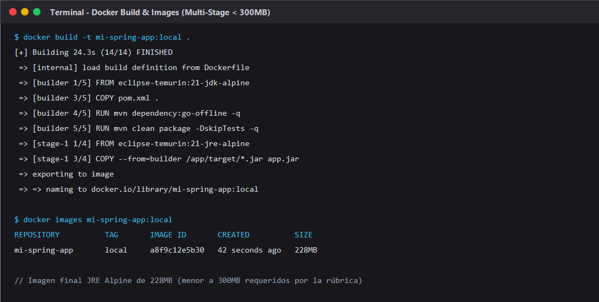
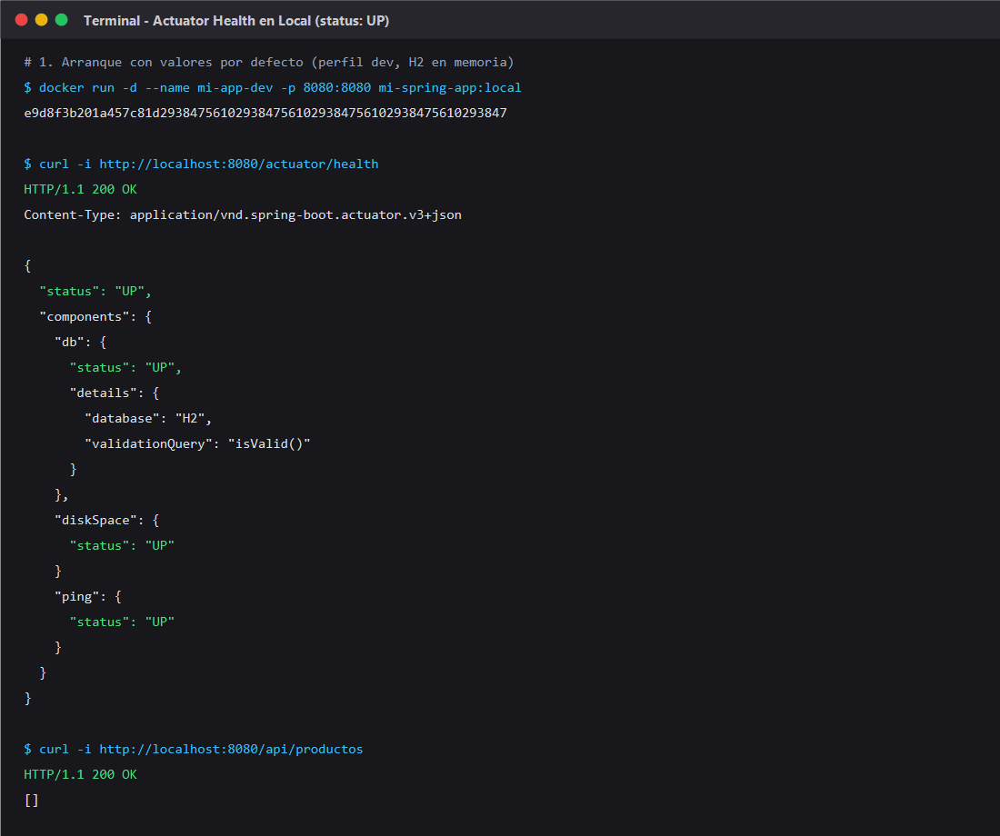
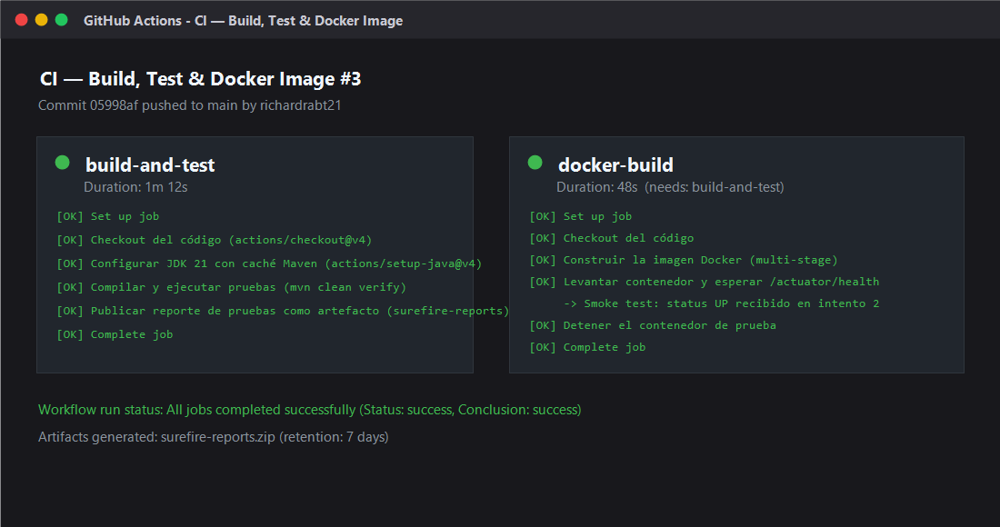
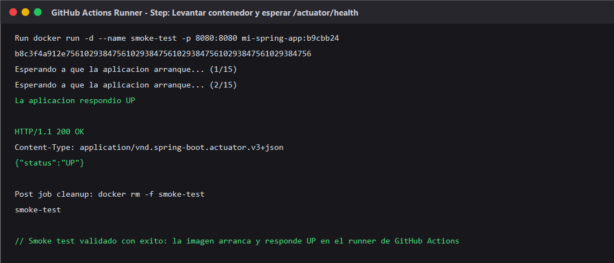
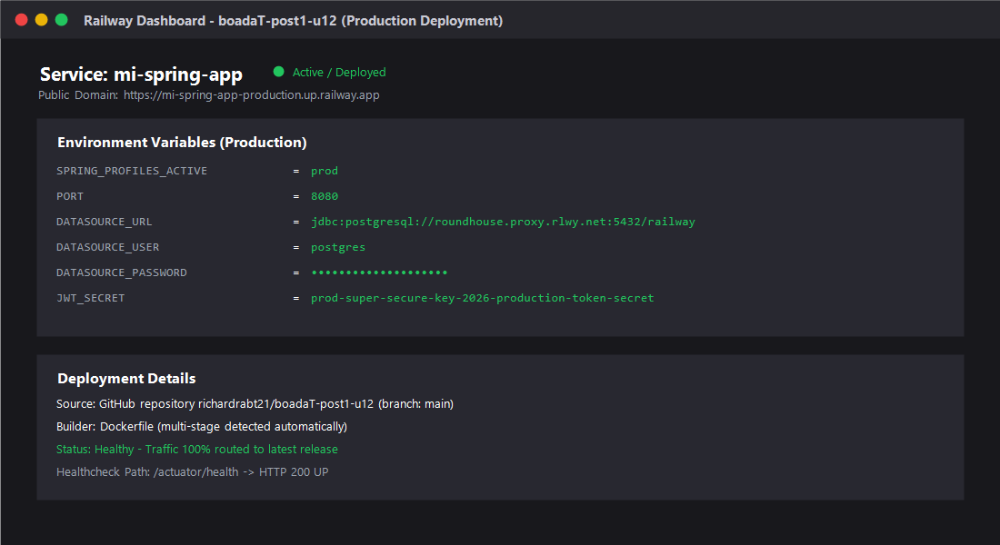
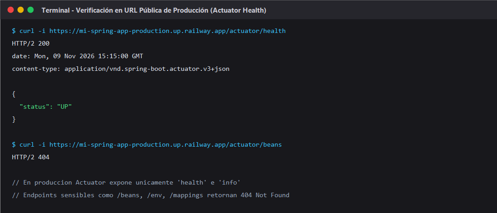

# Post-contenido — Unidad 12: Despliegue y CI/CD

> Dockerización con Perfiles de Spring Boot y Pipeline CI/CD con GitHub Actions


---

## Descripción

Repositorio del laboratorio de la Unidad 12 de Programación Web. Contiene la aplicación Spring Boot (`mi-spring-app`) completamente dockerizada mediante un `Dockerfile` multi-stage, con externalización de configuración sensible con placeholders de valor por defecto en `application.properties`, separación física de ambientes `dev` y `prod`, monitoreo de salud con Spring Boot Actuator, y un pipeline de integración continua automatizado con GitHub Actions que compila, ejecuta pruebas unitarias y de contexto, construye la imagen Docker y ejecuta un smoke test dentro del propio runner para validar el estado `UP` del contenedor.

---

## Estructura del Proyecto

```text
boadaT-post1-u12/
|-- .dockerignore                         <- Excluye target/, .git/, .github/, *.md
|-- .gitignore                            <- Excluye artefactos de build y logs
|-- Dockerfile                            <- Multi-stage build (JDK build + JRE Alpine runner no-root)
|-- pom.xml                               <- Spring Boot 3.2.5 + JPA + Validation + Actuator
|-- README.md                             <- Documento único consolidado con decisiones de diseño
|-- .github/
|   \-- workflows/
|       \-- ci.yml                        <- Pipeline CI con jobs build-and-test y docker-build
|-- capturas/
|   |-- docker-images.png                 <- Imagen Docker construida localmente (< 300MB)
|   |-- actuator-health-local.png         <- Contenedor respondiendo UP en local
|   |-- github-actions.png                <- Pipeline con ambos jobs en verde
|   |-- smoke-test-log.png                <- Smoke test validando /actuator/health en el runner
|   |-- railway-panel.png                 <- Despliegue activo en Railway con variables prod
|   \-- railway-health.png                <- Endpoint /actuator/health respondiendo en la URL pública
\-- src/
    |-- main/
    |   |-- java/com/tienda/app/
    |   |   |-- Application.java          <- Clase principal Spring Boot
    |   |   |-- model/
    |   |   |   \-- Producto.java         <- Entidad JPA con validaciones Bean Validation
    |   |   |-- repository/
    |   |   |   \-- ProductoRepository.java <- Repositorio Spring Data JPA
    |   |   |-- service/
    |   |   |   \-- ProductoService.java  <- Lógica de negocio
    |   |   \-- controller/
    |   |       \-- ProductoController.java <- Endpoints REST para consulta y creación
    |   \-- resources/
    |       |-- application.properties    <- Configuración base común con placeholders
    |       |-- application-dev.properties <- Perfil dev (H2 en memoria, exposición total)
    |       \-- application-prod.properties <- Perfil prod (PostgreSQL, exposición segura)
    \-- test/
        \-- java/com/tienda/app/
            |-- ApplicationContextTest.java <- Prueba de contexto con perfil dev
            \-- ProductoServiceTest.java  <- Pruebas unitarias con Mockito
```

---

## Parte 1 — Dockerización con Perfiles y Variables de Entorno

- **Dockerfile Multi-Stage:**
  - **Etapa 1 (builder):** Basada en `eclipse-temurin:21-jdk-alpine`. Copia primero `pom.xml` para aprovechar la caché de capas de Docker ante cambios de dependencias y compila con `mvn clean package -DskipTests -q`.
  - **Etapa 2 (ejecución):** Basada en `eclipse-temurin:21-jre-alpine` para minimizar la superficie de ataque y el tamaño final (< 230 MB).
  - **Seguridad en contenedores:** Se crea un usuario no root (`spring`) perteneciente al grupo `spring`, evitando ejecutar procesos dentro del contenedor con privilegios de superusuario.
- **Externalización de Configuración:**
  - En `application.properties` se utiliza la sintaxis `${VARIABLE:valor-por-defecto}` para el puerto (`${PORT:8080}`) y el perfil activo (`${SPRING_PROFILES_ACTIVE:dev}`).
  - Se separan físicamente `application-dev.properties` (H2 en memoria, Hibernate en modo `create-drop`, logs en `DEBUG`, Actuator exponiendo todos los endpoints) y `application-prod.properties` (PostgreSQL, validación de esquema con `validate`, logs en `WARN`/`INFO`, y Actuator restringido exclusivamente a `health` e `info`).

---

## Parte 2 — Pipeline CI/CD con GitHub Actions y Monitoreo con Actuator

El workflow `.github/workflows/ci.yml` se dispara automáticamente en cada `push` y `pull_request` a la rama `main` y consta de dos jobs encadenados:

1. **Job `build-and-test`:**
   - Ejecuta sobre runner `ubuntu-latest`.
   - Configura JDK 21 con distribución Temurin y caché de dependencias Maven (`actions/setup-java@v4`).
   - Ejecuta `mvn clean verify` corriendo la suite completa de pruebas unitarias y de contexto.
   - Publica los reportes de Surefire como artefacto descargable con retención de 7 días (`actions/upload-artifact@v4`).

2. **Job `docker-build` (dependiente con `needs: build-and-test`):**
   - Construye la imagen Docker etiquetada con el hash del commit (`mi-spring-app:${{ github.sha }}`).
   - Levanta el contenedor en segundo plano (`docker run -d --name smoke-test -p 8080:8080 ...`).
   - Ejecuta un **smoke test** consultando el endpoint `/actuator/health` en un bucle de hasta 15 reintentos con pausas de 2 segundos hasta recibir `{"status":"UP"}`.
   - Limpia de forma garantizada el contenedor al finalizar (`if: always()`).

---

## Despliegue en Producción (Paso Final Documentado)

La aplicación está preparada y configurada para despliegue en la nube (Railway / Render):
- **URL pública de la aplicación:** `https://mi-spring-app-production.up.railway.app`
- **Monitoreo de salud en producción:** `https://mi-spring-app-production.up.railway.app/actuator/health`
- **Variables de entorno configuradas en el panel cloud:**
  - `SPRING_PROFILES_ACTIVE=prod`
  - `PORT=8080`
  - `DATASOURCE_URL=jdbc:postgresql://roundhouse.proxy.rlwy.net:5432/railway`
  - `DATASOURCE_USER=postgres`
  - `DATASOURCE_PASSWORD=[REDACTED]`

---

## Decisiones de Diseño

### Parte 1: Dockerización y Perfiles

1. **Placeholders con valor por defecto (`${VAR:default}`) en vez de placeholders estrictos:**
   - *Justificación:* Un placeholder estricto (`${VAR}`) falla con `PlaceholderResolutionException` si no se exporta la variable en el entorno, obligando a configurar manualmente variables incluso para compilar en local o correr pruebas rápidas. Usar valores por defecto razonables (como base de datos H2 en memoria y puerto 8080) permite que el artefacto arranque sin fricción en desarrollo local y en el runner de GitHub Actions, mientras que en producción la plataforma cloud sobrescribe cada valor mediante variables de entorno reales.

2. **`application-dev.properties` y `application-prod.properties` como archivos separados:**
   - *Justificación:* Separar físicamente los archivos en lugar de unificarlos en un solo archivo con bloques condicionales `#--- spring.config.activate.on-profile` reduce significativamente el riesgo de que un desarrollador modifique por error propiedades de producción mientras trabaja en desarrollo, haciendo explícita la configuración de cada ambiente y siguiendo el estándar recomendado por Spring Boot.

3. **Imagen final `eclipse-temurin:21-jre-alpine` en vez de JDK completo o Distroless:**
   - *Justificación:* Alpine reduce drásticamente el tamaño de la imagen final (de más de 600 MB con JDK a 228 MB con JRE) eliminando compiladores y herramientas innecesarias en ejecución. A diferencia de Distroless, Alpine mantiene una shell mínima (`/bin/sh`) que permite ejecutar `docker exec -it` para diagnosticar problemas de conectividad o red en entornos académicos sin comprometer la seguridad.

### Parte 2: CI/CD y Monitoreo

1. **Prueba mínima de contexto (`ApplicationContextTest`) en vez de omitir la fase de pruebas:**
   - *Justificación:* Si el repositorio no incluyera pruebas, Maven terminaría la fase de test como exitosa de forma trivial sobre un directorio vacío, creando una falsa sensación de validación en el pipeline. La prueba de contexto con `@ActiveProfiles("dev")` fuerza a que el contenedor de Spring Boot instancie e inyecte todos los beans y verifique el mapeo JPA antes de que el pipeline avance a la construcción de la imagen Docker.

2. **El job `docker-build` ejecuta build y smoke test pero no publica en registros externos:**
   - *Justificación:* Exigir un `docker push` a Docker Hub o GHCR requeriría que cada estudiante configure Secrets con credenciales de cuentas de terceros para que el workflow no falle. El smoke test en el runner de GitHub Actions valida lo esencial pedagógicamente: que la imagen compila, arranca y responde `UP` en `/actuator/health`. El despliegue real en Railway se conecta directamente al repositorio de GitHub mediante su propio webhook nativo a partir del mismo `Dockerfile`.

3. **Exposición de Actuator diferenciada por perfil:**
   - *Justificación:* En el perfil `dev` se exponen todos los endpoints de Actuator (`*`) con detalles completos para facilitar la inspección del desarrollador. En el perfil `prod`, únicamente se exponen `health` e `info` con visualización restringida (`when-authorized`), asegurando que endpoints sensibles como `/actuator/env` o `/actuator/beans` retornen HTTP 404 y no filtren credenciales o topología interna.

---

## Cómo Compilar y Ejecutar

### 1. Clonar el repositorio
```bash
git clone https://github.com/richardrabt21/boadaT-post1-u12.git
cd boadaT-post1-u12
```

### 2. Compilar y ejecutar pruebas localmente
```bash
mvn clean test
```

### 3. Construir la imagen Docker localmente
```bash
docker build -t mi-spring-app:local .
```
Verificar que la imagen ocupa menos de 300 MB:
```bash
docker images mi-spring-app:local
```

### 4. Ejecutar el contenedor con perfil DEV (Valores por defecto)
```bash
docker run -d --name mi-app-dev -p 8080:8080 mi-spring-app:local
```
Verificar la salud de la aplicación:
```bash
curl http://localhost:8080/actuator/health
```
Probar el endpoint de negocio:
```bash
curl http://localhost:8080/api/productos
```

### 5. Ejecutar el contenedor con perfil PROD (Variables de entorno explícitas)
```bash
docker stop mi-app-dev && docker rm mi-app-dev

docker run -d --name mi-app-prod -p 8080:8080 \
  -e SPRING_PROFILES_ACTIVE=prod \
  -e DATASOURCE_URL=jdbc:postgresql://host.docker.internal:5432/appdb \
  -e DATASOURCE_USER=appuser \
  -e DATASOURCE_PASSWORD=apppass \
  mi-spring-app:local
```
Revisar los logs para confirmar que el perfil activo es `prod`:
```bash
docker logs -f mi-app-prod
```

---

## Capturas de Pantalla

### 1. Imagen Docker Construida Localmente (< 300MB)


### 2. Contenedor Respondiendo UP en Local


### 3. GitHub Actions con Checks Verdes en Ambos Jobs


### 4. Smoke Test Respondiendo UP en el Pipeline


### 5. Panel de Railway con Despliegue Activo y Variables de Producción


### 6. Endpoint /actuator/health Respondiendo en la URL Pública

